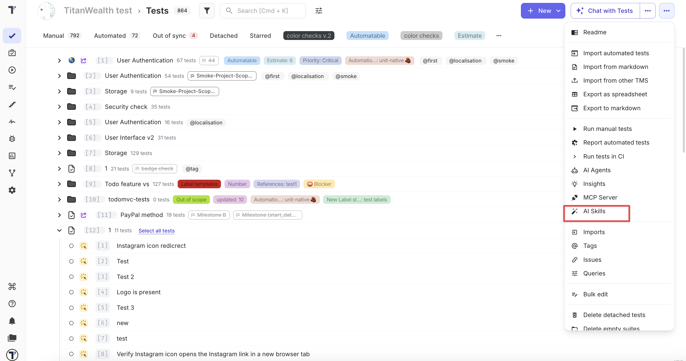
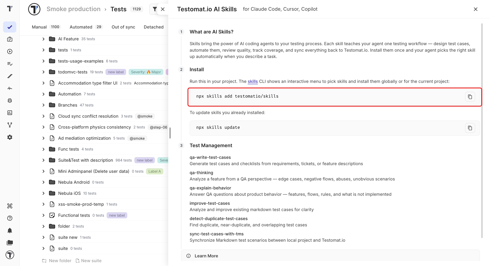

Teach your coding agent how to test. Each AI Skill covers one testing workflow, such as writing test cases or finding duplicates. 

**Before You Start**

- Company should be on the Enterprise plan.
- Use a coding agent such as Claude Code, Cursor, or Copilot.
- Install Node.js is installed.

## Open AI Skills

1. Open the **Tests** page.
2. Click the **⋯** button in the top-right corner, next to **Chat with Tests**.
3. Select **AI Skills**. You'll find it in the AI group of the menu, below **AI Agents** and **MCP Server**.



The **Testomat.io AI Skills** panel opens on the right.

:::note

AI Skills are available on the Enterprise plan. On other plans, **AI Skills** is greyed out in the menu. See [Plan Features Comparison](https://docs.testomat.io/management/company/plan-features-comparison).

:::

## Install the Skills

1. In the **Install** section, click the copy icon next to the install command.
2. Run the command in your project:

```bash
npx skills add testomatio/skills
```

3. Pick the skills you want in the menu, and choose whether to install them for this project or for all projects.



Your agent now has the skills. Describe a task, for example "write test cases for the login page", and it uses the matching skill.

## Update the Skills

Run this command to get the latest version of the skills you installed:

```bash
npx skills update
```

## Available Skills

| Skill | What it does |
| --- | --- |
| `qa-write-test-cases` | Writes test cases and checklists from requirements, tickets, or feature descriptions. |
| `qa-thinking` | Looks at a feature the way a tester does: edge cases, negative flows, and unobvious scenarios. |
| `qa-explain-behavior` | Answers questions about how the product behaves. |
| `improve-test-cases` | Makes existing Markdown test cases clearer. |
| `detect-duplicate-test-cases` | Finds duplicates, near-duplicates, and overlaps. |
| `sync-test-cases-with-tms` | Syncs Markdown test cases between your project and Testomat.io. |

For the full catalog and setup for each agent, see [testomat.ai/qa-skills](https://testomat.ai/qa-skills).

## Next Steps

- [MCP - Connect with a Config File](https://docs.testomat.io/tutorials/mcp-connection)
- [AI-Powered Features](https://docs.testomat.io/advanced/ai-powered-features)
