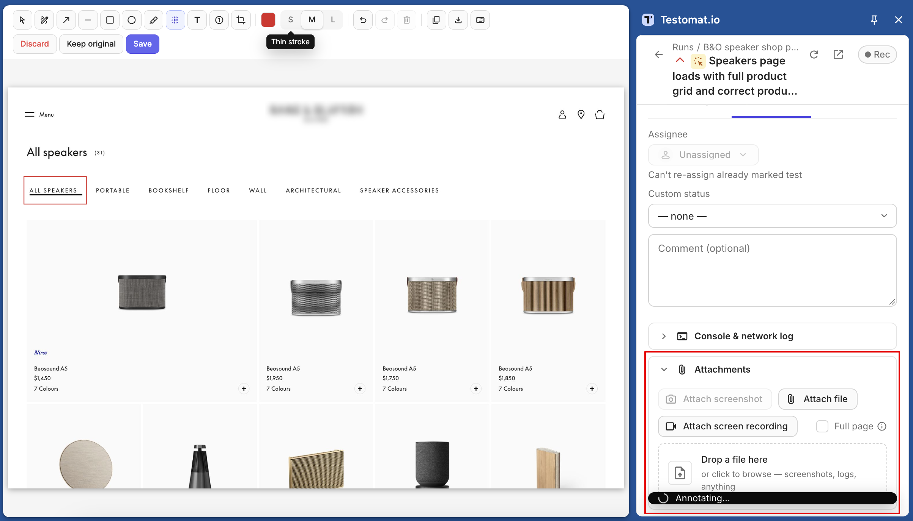
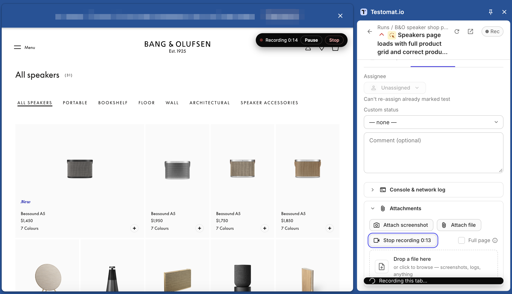
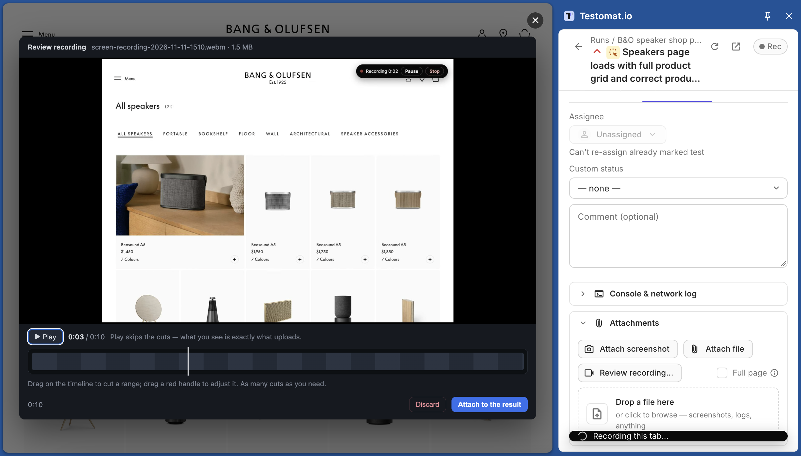
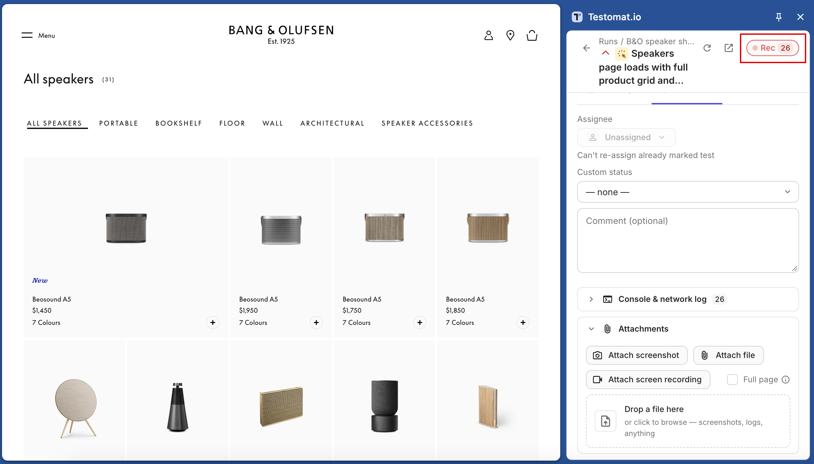

Show what went wrong without leaving the page you're testing. Everything you capture is attached to the result of the test that's open in the panel.

**Before you start**

Open a test in a run and expand **Attachments**. If the buttons are greyed out, the reason is shown right below them: the test has no result yet, the run is finished, or the panel is in basic mode.

## Take a Screenshot

1. Click **Attach screenshot**. The panel captures the tab and opens the annotation editor on top of the page.
2. Mark up the picture with the tools below.
3. Click **Save** or press `Cmd/Ctrl+Enter`. The screenshot is attached to the result.

Click **Keep original** to attach the screenshot without annotations, or **Discard** (`Esc`) to attach nothing. If you've already added annotations, the panel asks you to confirm.

| Tool | Key | What It Does |
|---|---|---|
| Select | `V` | Move an annotation, double-click a label to edit it, `Delete` removes it |
| Pen | `P` | Draw freehand |
| Arrow | `A` | Point at something |
| Line | `L` | Draw a straight line |
| Box | `R` | Frame an area |
| Ellipse | `O` | Circle an area |
| Highlight | `H` | Mark with translucent ink |
| Blur | `B` | Hide sensitive data |
| Text | `T` | Click, type, press `Enter` |
| Number | `N` | Add numbered markers 1, 2, 3; `S` / `M` / `L` set the size |
| Crop | `C` | Keep only the selected area |

You can edit any annotation until you click **Save**.

:::note

Blur can't be undone after you save. The blurred pixels are removed from the uploaded file, so it's safe to use on tokens and personal data.

:::

### Capture the Full Page

Turn on **Full page** in **Attachments** before you click **Attach screenshot**. The screenshot then covers the whole page, including the part below the scroll.

Full-page screenshots use Chrome's debugger, so Chrome shows a "…is debugging this browser" bar during the capture. That's expected — the bar closes by itself. On pages that block the debugger, such as `chrome://` pages, the panel takes a screenshot of the visible area and lets you know.

## Record Your Screen

You can start recording in three ways:

- click **Attach screen recording** in **Attachments**;
- press `Alt+Shift+R` on the page;
- right-click the page and choose **Testomat.io** → start recording.

While recording, the controls stay on the page: a timer, **Pause / Resume**, and **Stop**. Recordings are without sound. A recording stops on its own after 5 minutes or 50 MB.

:::note

When you start recording from the panel button, Chrome shows a "…is debugging this browser" bar until you stop. To avoid it, start from the page with `Alt+Shift+R` or the right-click menu.

:::

### Review and Trim the Recording

When you click **Stop**, a review window opens over the page with a player and a timeline.

1. Click **Play** to watch the recording.
2. To cut a part out, drag over it on the timeline. To undo a cut, click ✕ on its chip under the timeline.
3. Click **Attach to the result**. Only the parts you kept are uploaded.

Nothing uploads until you decide. If you close the review, the recording waits in the panel, and the button reads **Review recording…**. To delete the recording, click **Discard**.

## Collect Console and Network Logs

The panel can record console errors, warnings, and network requests from the tested tab. It keeps the last 60 seconds, so turn recording on **before** you reproduce the bug.

1. Open the test and click **Rec** in the panel header.
2. Reproduce the problem on the page. The **Rec** button counts errors as they happen. To see them, open **Console & network log** in the test. Each failed request shows its method, URL, and status.
3. Mark the test **Failed**. The log is attached to the result as a `.txt` file with Console and Network sections.

For failed requests, the log also saves the first 16 KB of the response body. URLs are saved without query parameters by default, so tokens in links stay out of the file. To change any of this, or the 60-second window, go to [Settings → Failure Log](/advanced/browser-extension/settings/#failure-log).

## Next Steps

- [Run Manual Tests](/advanced/browser-extension/run-tests/)
- [Settings](/advanced/browser-extension/settings/)
