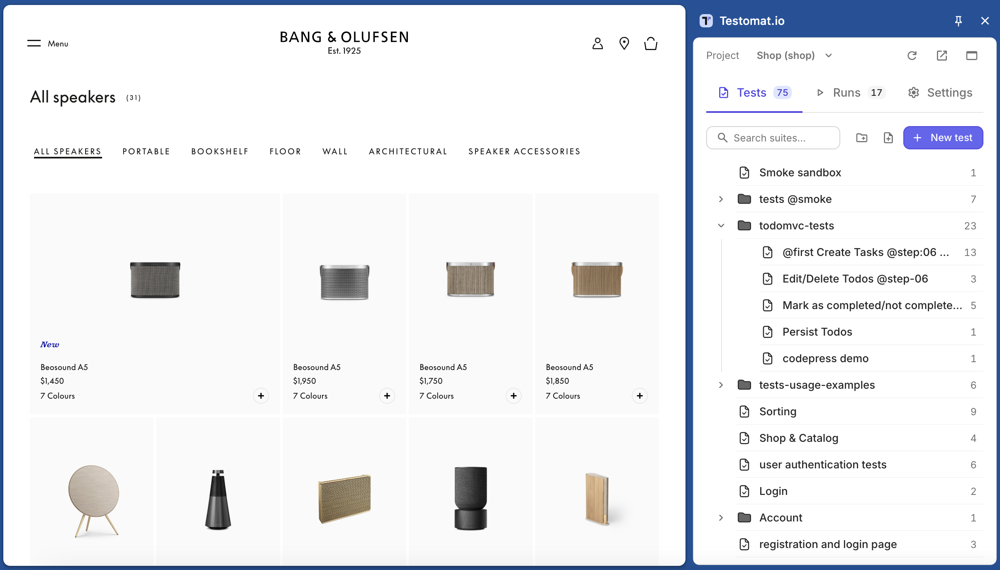
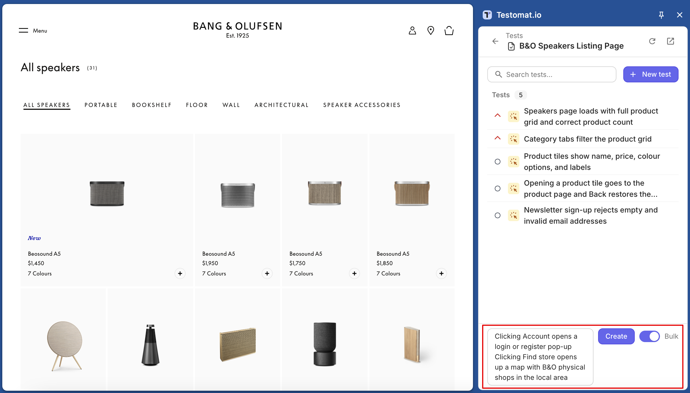
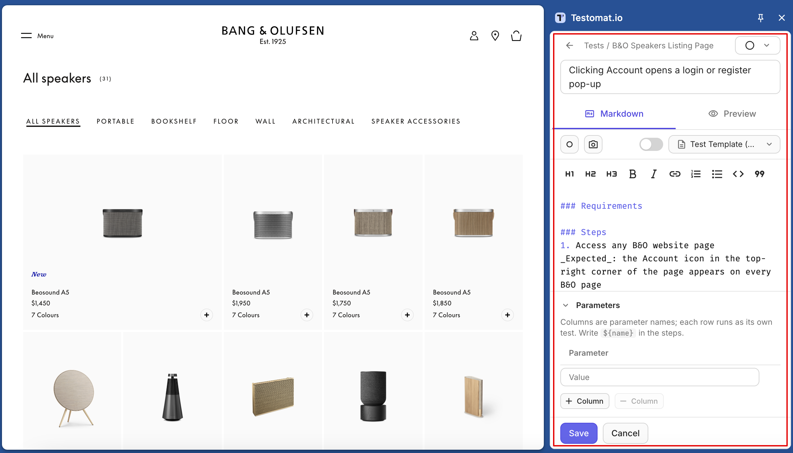
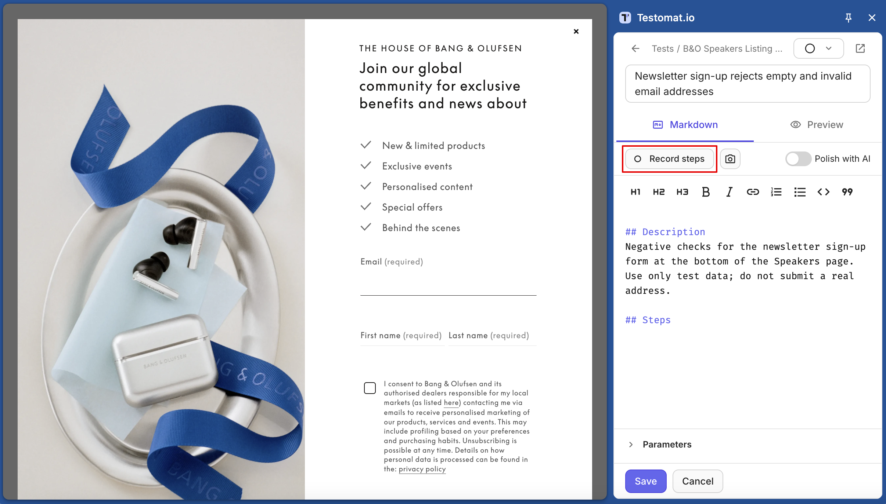
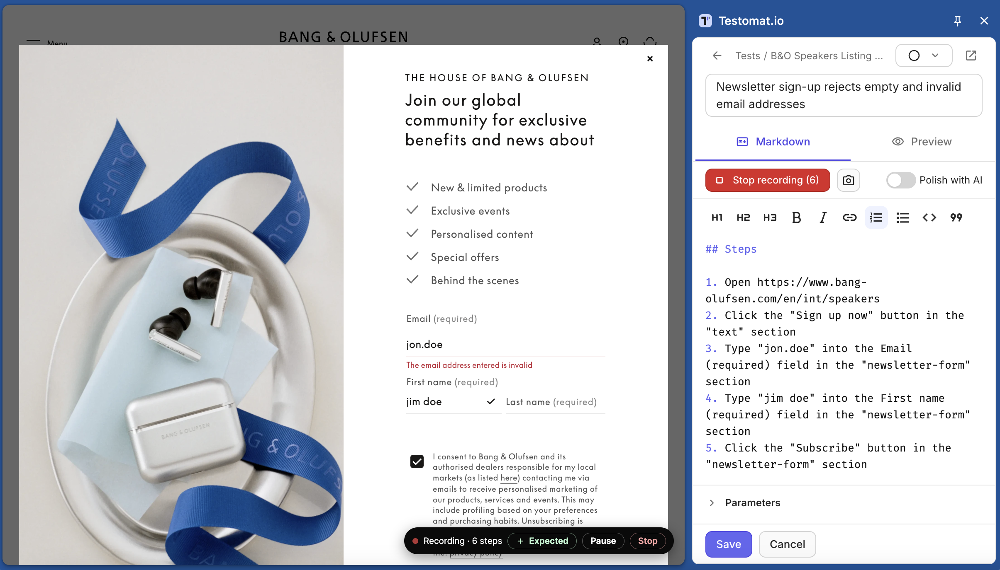
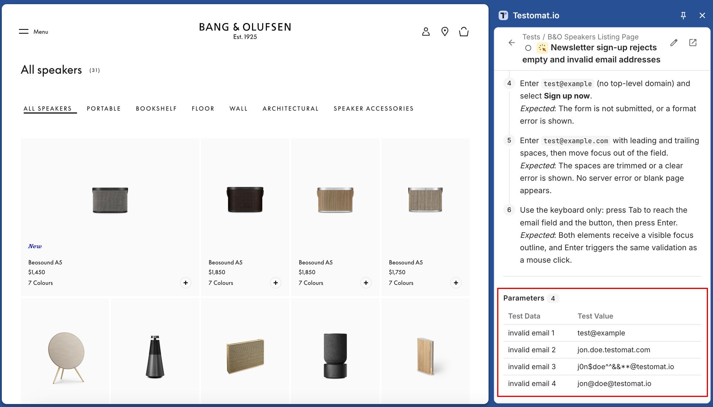

Write new test cases while you explore the website. The **Tests** tab shows the project's suite tree with test counts. 

## Add Tests by Title

1. Open a suite.
2. Type a title in **Add new test** at the bottom and click **Create** or press `Enter`. 

The test is added to the suite, and you can fill it in later.

To add several tests at once, turn on **Bulk** and enter one title per line. The tests are created in the same order.

## Write a Test in the Editor

1. Click **New test**. The editor opens.
2. Enter the title. If you started from the top of the tree, choose a suite.
3. Write the description and steps in Markdown. 
4. Save the test.

To create a suite or folder, use the **+** buttons in the tree.

## Record Steps

Instead of typing steps, go through the flow on the website once. The extension turns your clicks, text entry, selections, and page navigation into readable steps.

1. Open the website you want to test, then start a new test in the editor.
2. Click **Record steps**. A recording bar appears in the bottom-right corner of the page.
3. Go through the flow. Each action appears in the test's steps a second after you do it.
4. Click **Stop** in the bar or in the editor.

Recorded steps read like this: *Click the "Add to cart" button*, *Type "pliers" into the Search field*. When a page opens, the extension adds an `Expected:` line under the step that opened it, for example *The "Cart" page opens*.

While recording:

- **+ Expected** adds your own expected result to the last step. Type it and press `Enter`.
- **Pause** stops recording for a moment, for example to do something that isn't part of the test. Click **Resume** to continue.
- After 50 steps, recording pauses and asks **Still recording?**. Click **Continue** to add 50 more.

### Sensitive Values

The extension recognizes passwords, card numbers, one-time codes, and similar fields, and doesn't save their values. The step names the field but not what you typed: *Type the password into the Password field*.

This works on a best-effort basis. If the website handles real payment or personal data, turn on **Never record entered values** in [Settings](/advanced/browser-extension/settings/#step-recorder) — then no typed value is saved.

### Polish with AI

If Testomat.io AI is enabled for your company, turn on **Polish with AI** next to **Record steps**. When you stop recording, the AI rewrites the steps in clearer language. To get the original wording back, click **Undo polish**.

If AI isn't available for your company, the switch stays off and tells you why when you click it, and nothing is sent. On a Testomat.io server without AI, the switch isn't shown.

## Add Parameters

Use parameters to run the same test with different data, such as different user roles.

1. In the editor, open **Parameters** and name the columns, for example `role` and `email`.
2. Add one row per data set.
3. Use `${role}` and `${email}` in the title or steps.

In a run, the test shows one row per data set, and you mark each one separately.

## Next Steps

- [Run Manual Tests](/advanced/browser-extension/run-tests/)
- [Settings](/advanced/browser-extension/settings/)
