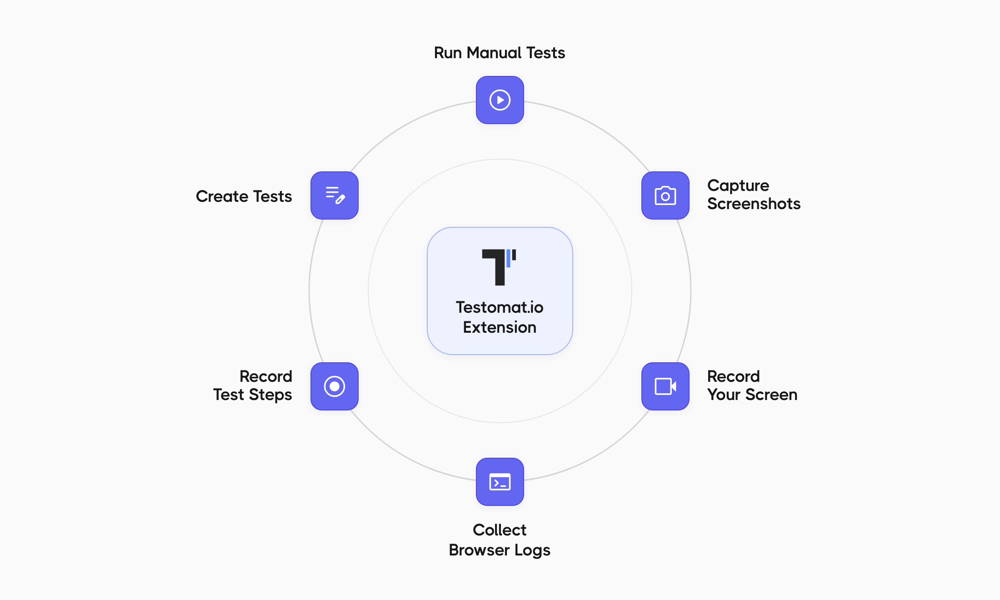

The Testomat.io Browser Extension opens your tests in a Chrome side panel, right next to the website you're testing. Run tests, collect evidence, and write new test cases without switching tabs.

## What You Can Do

| Task | What It Does |
|---|---|
| [Run manual tests](/advanced/browser-extension/run-tests/) | Follow test steps, mark each test as Passed, Failed, or Skipped, and add comments |
| [Capture screenshots](/advanced/browser-extension/attachments/) | Take a screenshot of the visible tab or the full page, then annotate, crop, or blur it |
| [Record your screen](/advanced/browser-extension/attachments/) | Record the tab you're testing and trim the video before attaching it |
| [Collect browser logs](/advanced/browser-extension/attachments/) | Capture console errors, warnings, and network requests, and attach them to a failed test |
| [Create tests](/advanced/browser-extension/create-tests/) | Add a test by title or write it in Markdown, with parameters |
| [Record test steps](/advanced/browser-extension/create-tests/#record-steps) | Go through a flow on the website — the extension writes the steps for you |

## Requirements

- A Testomat.io account on app.testomat.io or a self-hosted Testomat.io instance.
- Google Chrome 123 or newer.

## Privacy

- The extension has no server of its own. Everything you upload goes directly to the Testomat.io instance you connect it to.
- Your access token is stored in your browser. The extension also reads project members' names, email addresses, avatars, and time zones so you can see and assign tests.
- Screenshots, recordings, logs, and recorded steps can contain anything visible on the tested website, including personal or payment details. Password and card fields are masked in recorded steps on a best-effort basis.
- If you use app.testomat.io and turn on **Polish with AI**, the selected content is sent to Testomat.io's AI provider, Groq.
- The extension has no analytics, telemetry, or ads.

To see exactly what is stored and sent, why the extension needs each Chrome permission, and how to turn each feature off, read [PRIVACY.md on GitHub](https://github.com/testomatio/browser-extension/blob/main/PRIVACY.md). For Testomat.io as a whole, see the [Testomat.io Privacy Policy](https://testomat.io/privacy-policy/).

## Open Source

The extension is open source under the MIT license. The source code and developer docs are on [GitHub](https://github.com/testomatio/browser-extension).

### Report a Bug or Request a Feature

Open an issue in the [extension's GitHub repository](https://github.com/testomatio/browser-extension/issues). To help us fix it faster, include:

- what you clicked and what happened, with the exact wording of any message;
- your Chrome version (see `chrome://settings/help`);
- whether the **Basic mode** pill was showing in the panel.

Leave out access tokens and any run URLs you'd rather keep private.

## Next Steps

- [Install and Connect](/advanced/browser-extension/install/)
- [Run Manual Tests](/advanced/browser-extension/run-tests/)
