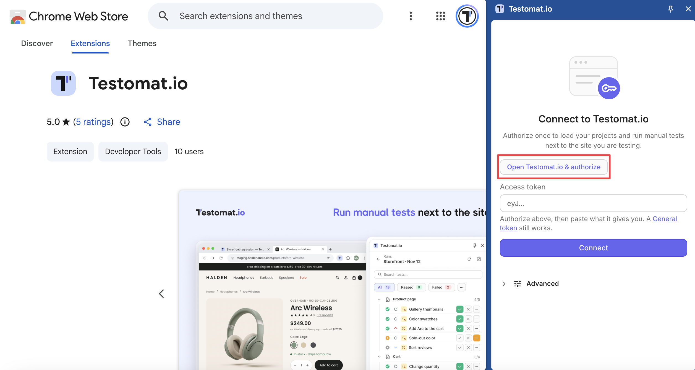
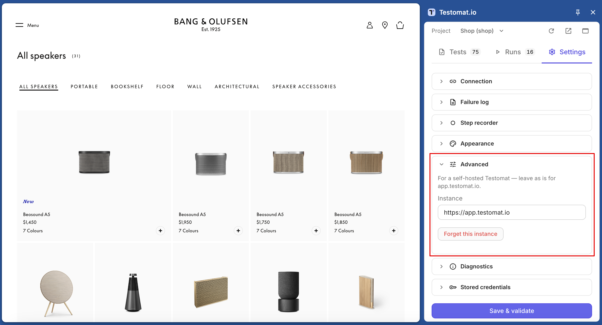
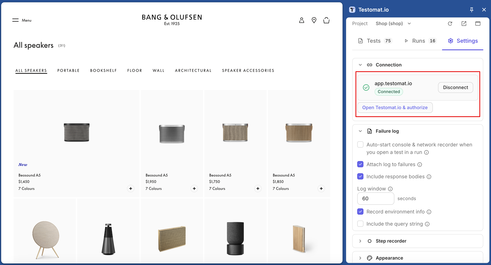
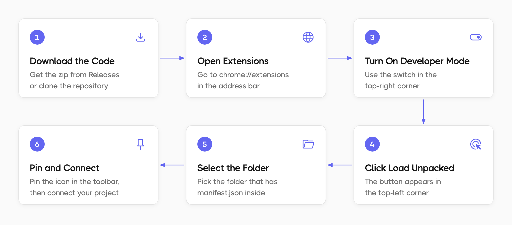

Add the extension to Chrome and connect it to your project. It takes a couple of minutes, and you do it only once.

## Install from the Chrome Web Store

1. Open [Testomat.io on the Chrome Web Store](https://chromewebstore.google.com/detail/testomatio/amcnjlghmkkjfaajanfeghpgbjakdcka).
2. Click **Add to Chrome**, then click **Add extension** in the dialog.
3. Click the puzzle icon in Chrome's toolbar, then click the pushpin next to **Testomat.io**. The extension icon now stays in the toolbar.
4. Click the Testomat.io icon. The side panel opens on the **Connect to Testomat.io** screen.

## Connect to Your Project

You authorize once. After that, the extension finds each project's API key on its own, so you don't need to copy any keys.

1. Click **Open Testomat.io & authorize**. Testomat.io opens in a new tab and shows an access token. Sign in first if it asks you to.
2. Copy the token, paste it into **Access token**, and click **Connect**.
3. On the **Choose a project** screen, find your project and click it.

That's it — the panel is connected. You can switch to another project any time from the panel header.

:::note

A **General token** works too. Create one in Testomat.io under **Account → Access Tokens** and paste it into **Access token**.

:::

### Connect a Self-Hosted Instance

If your company runs its own Testomat.io server, set its address before you authorize:

1. On the connect screen, open **Advanced**.
2. Enter your server's `https://` URL in **Instance**. The panel connects only over HTTPS.
3. Continue from step 1 of [Connect to Your Project](#connect-to-your-project). The authorize button now opens your server.

## Check or End the Connection

1. Open **Settings**.
2. Go to **Connection**. The card shows the server you're connected to, the **Connected** badge, and the current project. 
3. To disconnect, click **Disconnect** — the panel returns to the connect screen.

## Basic Mode

If the panel loses its session with Testomat.io, it switches to basic mode instead of stopping. A banner tells you when this happens.

In basic mode you can still open runs, set statuses, and add comments. These features turn off until the session is back:

- finishing a run;
- priority, custom statuses, and assignee;
- syncing ticked steps — they stay only in your panel.

To get the full panel back, sign in to Testomat.io in the same browser and click **Refresh** on the banner.

## Install from GitHub

The extension is available on [GitHub](https://github.com/testomatio/browser-extension). Run the source code instead of the store version. The GitHub copy and the store copy share the same ID, so Chrome keeps only one of them. 

1. Get the extension folder in one of two ways:
   - download the newest `testomat-io-<version>.zip` from [Releases](https://github.com/testomatio/browser-extension/releases) — the file under **Assets** without `-webstore` in its name — and unpack it;
   - or clone the repository: `git clone https://github.com/testomatio/browser-extension.git`.
2. Open `chrome://extensions`.
3. Turn on **Developer mode** in the top-right corner.
4. Click **Load unpacked** and select the folder that has `manifest.json` directly inside: the unpacked folder from the zip, or the `extension/` folder in the cloned repository.
5. Pin the icon and connect, as described in [Install from the Chrome Web Store](#install-from-the-chrome-web-store) and [Connect to Your Project](#connect-to-your-project).

A copy loaded from GitHub doesn't update on its own. To update it, replace the folder contents with a newer version (or run `git pull`), then click the reload icon on the Testomat.io card in `chrome://extensions`. Your token, settings, and unsent results stay after the reload.

:::note

Before you start, remove the store copy in `chrome://extensions`. This also deletes its token and settings, so you'll need to connect again.

:::

## Next Steps

- [Run Manual Tests](/advanced/browser-extension/run-tests/)
- [Create Tests](/advanced/browser-extension/create-tests/)
