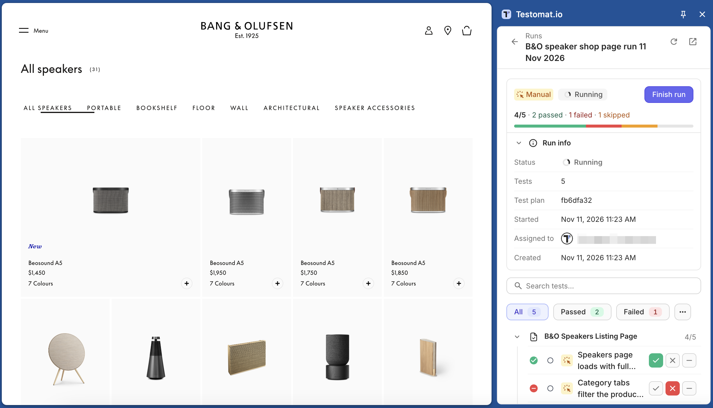
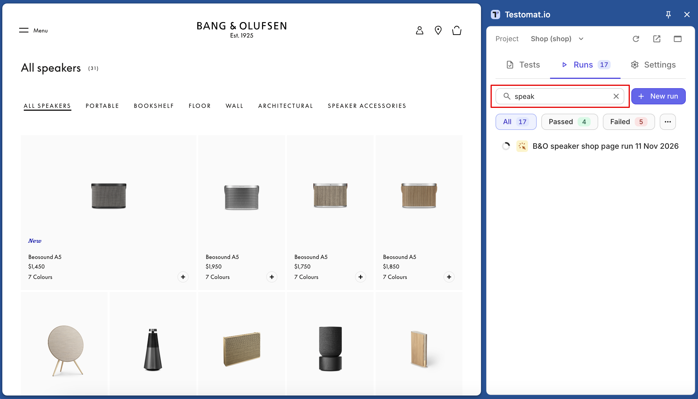
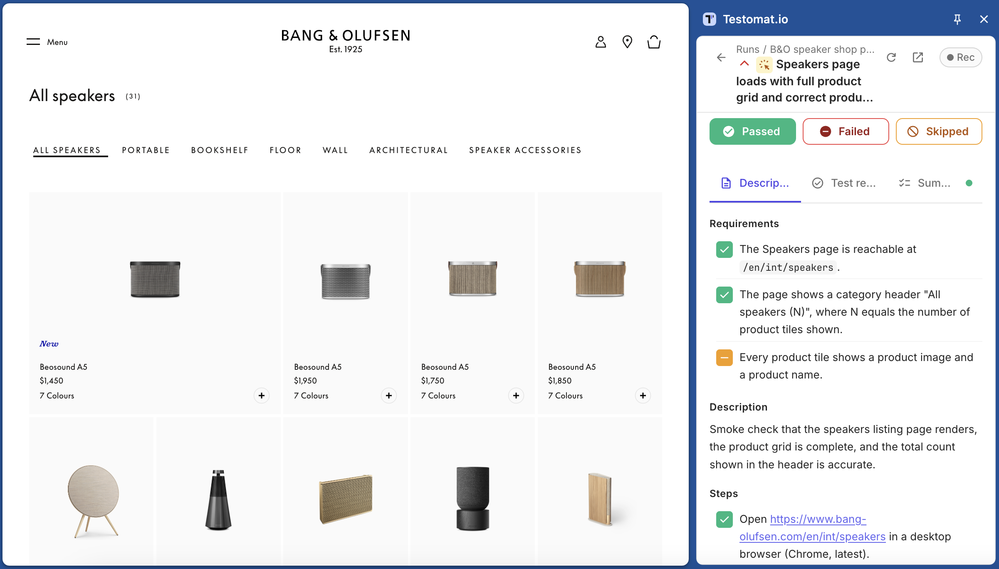

Go through a run in the side panel while the website you're testing stays open next to it. The panel never moves on by itself — you go to the next test when you're ready.

## Open a Run

1. Open the **Runs** tab.
2. Click a run. 
3. The run opens as a checklist grouped by suite, with a progress bar and status filters.

To create a new run, click **New run**. It opens the run creation page in Testomat.io. When you save the run, it appears in this list.

To find run fast, type part of its title in the search box or paste the run's URL from Testomat.io.

## Mark Tests

To mark a test quickly, use the ✓ / ✗ / − buttons on its row in the checklist. To tick steps, click the test's title to open it:

1. Click a step to tick it: once for passed, twice for failed, three times for skipped.
2. Add a comment if you need one.
3. Click **Passed**, **Failed**, or **Skipped**. The result saves with the comment.
4. Go to the next test with the **›** arrow under the progress bar, or press `N`.

A test with parameters shows one row per example. Mark each row on its own.

When you mark a test **Failed**, the panel can attach the browser log to it automatically. See [Attach Screenshots, Recordings, and Logs](/advanced/browser-extension/attachments/#collect-console-and-network-logs).

## Keyboard Shortcuts

These shortcuts work in an open test when no text field is active. Cmd and Ctrl both work on any system.

| Keys | Action |
|---|---|
| `Cmd/Ctrl+Enter` | Passed |
| `Cmd/Ctrl+U` | Failed |
| `Cmd/Ctrl+I` | Skipped |
| `N` | Next untested test |
| `↓` / `→`, `↑` / `←` | Next / previous test |

To see this list in the panel, click **?** next to the test pager.

## Finish the Run

Click **Finish run** at the top of the run. Confirm in the dialog — any tests you haven't marked become Skipped.

## Work with Colleagues and Offline

While a run is open, the panel refreshes it about every 20 seconds, so you see your colleagues' results. To refresh right now, click Refresh in the panel header.

If your connection drops, your results aren't lost. They wait in the panel with a `queued` badge and are sent when the connection returns, as long as the panel stays open. To send them right away, click **Retry**.

## Next Steps

- [Attach Screenshots, Recordings, and Logs](/advanced/browser-extension/attachments/)
- [Create Tests](/advanced/browser-extension/create-tests/)
