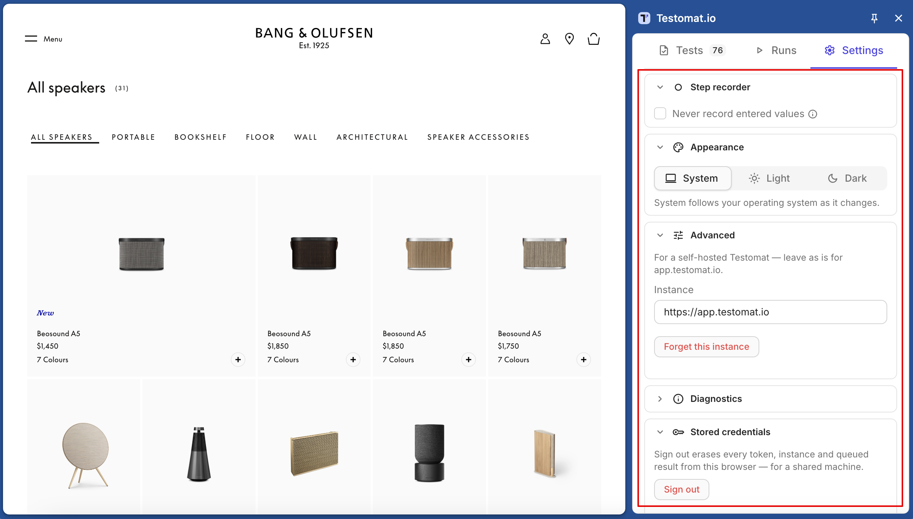
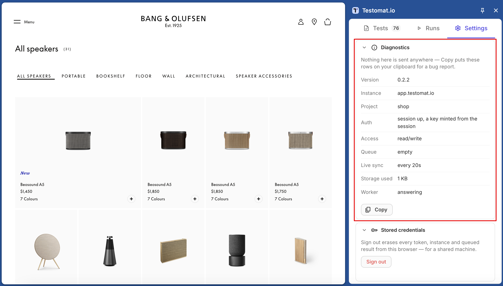

Choose what the extension records, how it looks, and which server it connects to. Open the **Settings** tab in the panel header. Click a section heading to expand it.

Click **Save & validate** at the bottom to apply your changes. It also checks the connection and then opens the **Runs** tab. Only **Appearance** applies right away.

Settings are saved separately for each Testomat.io server you connect to.

## Connection

Shows the server you're connected to and the current project. See [Install and Connect](/advanced/browser-extension/install/#check-or-end-the-connection).

## Failure Log

Controls what the panel records and attaches when you mark a test **Failed**. To learn how logging works, see [Collect Console and Network Logs](/advanced/browser-extension/attachments/#collect-console-and-network-logs).

| Setting | Default | What It Does |
|---|---|---|
| **Auto-start console & network recorder when you open a test in a run** | Off | Starts **Rec** when you open a test and stops it when you leave the test |
| **Attach log to failures** | On | Attaches the log to every test you mark Failed. When off, you can still attach a single log entry with **Attach** |
| **Include response bodies** | On | Saves up to 16 KB of the response for failed requests |
| **Log window** | 60 seconds | How much history the log keeps: from 10 to 600 seconds. Leave it empty for 60 |
| **Record environment info** | On | Adds the browser, OS, viewport size, and page URL to every result you set |
| **Include the query string** | Off | When off, URLs are saved without query parameters, so tokens in links stay private. This also applies to the first `Open` step in recorded steps |

## Step Recorder

| Setting | Default | What It Does |
|---|---|---|
| **Never record entered values** | Off | When on, no typed value is saved: steps read *Type text into the … field* and *Select an option in the … dropdown*. Turn it on if the website handles real payment or personal data. See [Sensitive Values](/advanced/browser-extension/create-tests/#sensitive-values) |

## Appearance

Choose **System**, **Light**, or **Dark**. The change stays the same for all projects and servers.

## Advanced

Used only for self-hosted Testomat.io. On app.testomat.io, you don't need it.

- **Instance** — your server's `https://` URL.
- **Pick a saved instance** — appears when you've saved two or more servers. Choose one and click **Save & validate** to switch to it.
- **Forget this instance** — deletes the saved token, project, and settings for this server, after you confirm. If it's the server you're using now, its queued results, recorded steps, logs, screen recordings, and unsaved drafts are deleted too, and the panel returns to the connect screen. Other servers aren't affected.

## Diagnostics

Shows the technical state of the extension in one place. Use it when something doesn't work as expected, or when you report a bug.

Nothing in this section is sent anywhere. Click **Copy** to copy all rows to your clipboard, then paste them into your bug report or support request.

| Row | What It Shows |
|---|---|
| **Version** | The installed extension version |
| **Instance** | The Testomat.io server the panel is connected to, such as app.testomat.io |
| **Project** | The current project |
| **Auth** | How the panel is signed in. If your web session has expired, the panel works in [basic mode](/advanced/browser-extension/install/#basic-mode) |
| **Access** | Your access to the project: read/write, or read-only |
| **Queue** | Results waiting to be sent. **empty** means everything is saved in Testomat.io |
| **Live sync** | How often an open run refreshes |
| **Storage used** | How much space the extension uses in your browser |
| **Worker** | Whether the extension's background process is running. **answering** means it is |

## Stored Credentials

On a shared computer, click **Sign out** when you're done. After you confirm, it deletes all saved tokens, servers, queued results, drafts, recorded steps, logs, and screen recordings from this browser. Your color scheme and panel layout stay.

## Side Panel or Window

To open the panel in a separate window, for example on a second screen, click **Open in window** in the panel header. To bring it back, click **Dock to side panel**. The extension remembers your choice.

## Keyboard Shortcuts

For shortcuts in an open test, see [Run Manual Tests](/advanced/browser-extension/run-tests/#keyboard-shortcuts). `Alt+Shift+R` starts or stops a screen recording from any tab. To change this shortcut, go to `chrome://extensions/shortcuts`.

## Next Steps

- [Install and Connect](/advanced/browser-extension/install/)
- [Run Manual Tests](/advanced/browser-extension/run-tests/)
