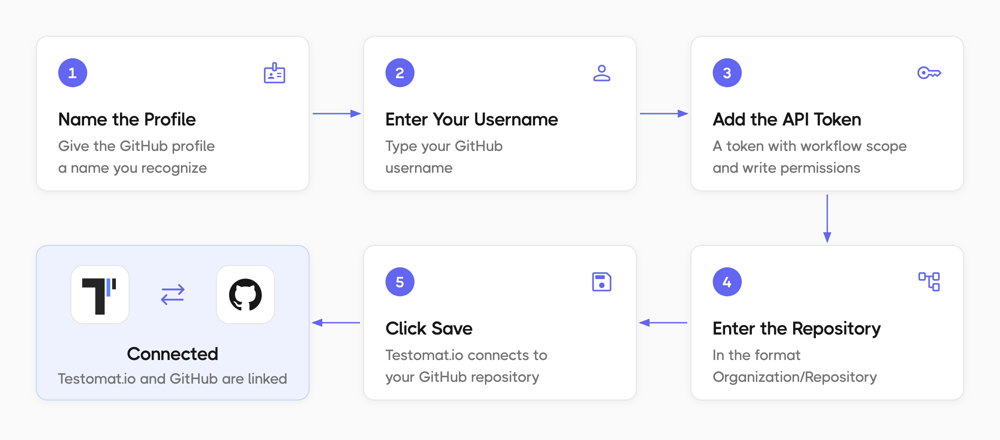
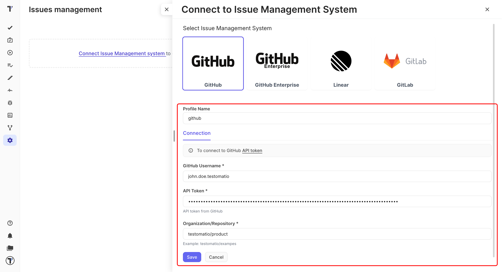

1. Give a name to your profile 
2. Enter your GitHub Username
3. Enter your GitHub API Token with access to workflow scope and write permissions ([learn more](https://docs.github.com/en/authentication/keeping-your-account-and-data-secure/creating-a-personal-access-token))
4. Enter your GitHub Organization/Repository
5. Click on Save button

Once your Issues Management System is configured you can link a test or create a defect. As a result, Testomat.io will create a ticket in your GitHub project with dedicated links and data, so you can easily look through the testing data you need. Here is an example:

## Connect GitHub Enterprise

If your repository is on GitHub Enterprise Cloud (`*.ghe.com`) or GitHub Enterprise Server, select **GitHub Enterprise** instead of **GitHub**, and fill in **GitHub Enterprise API URL**:

- GitHub Enterprise Cloud with data residency: `https://api.<your-tenant>.ghe.com`;
- GitHub Enterprise Server: `https://github.<your-company>.com/api/v3`.

The other fields are the same as for GitHub: **GitHub Username**, **API Token** (created in your GitHub Enterprise), and **Organization/Repository**.
