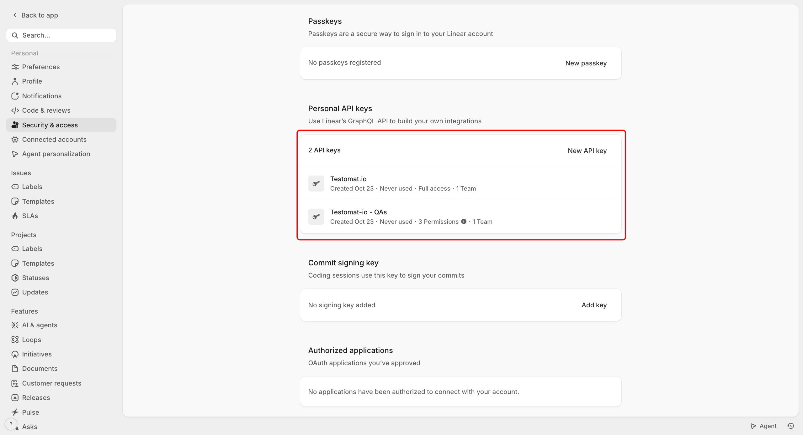
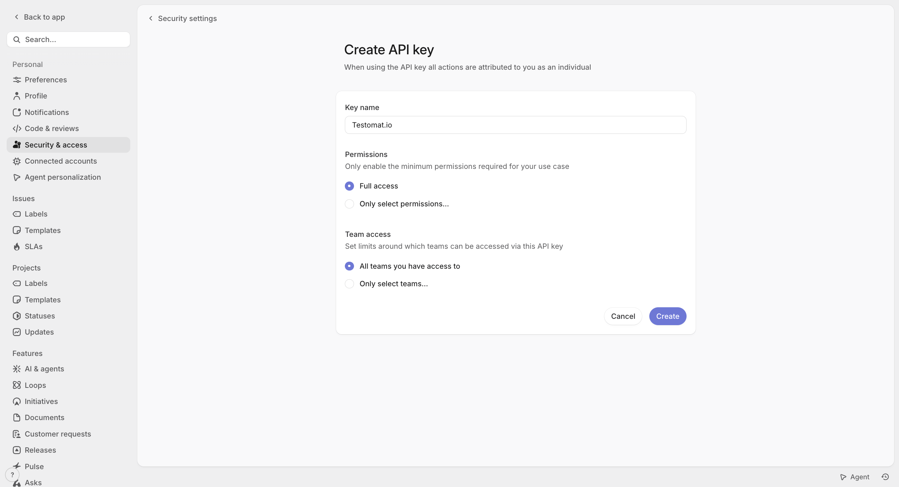
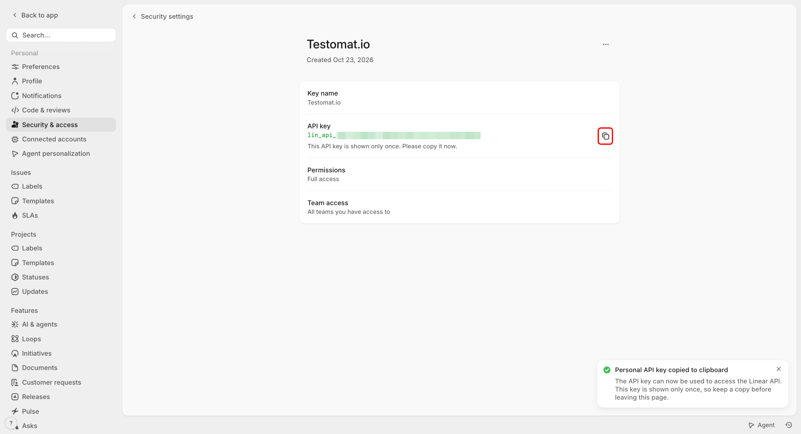
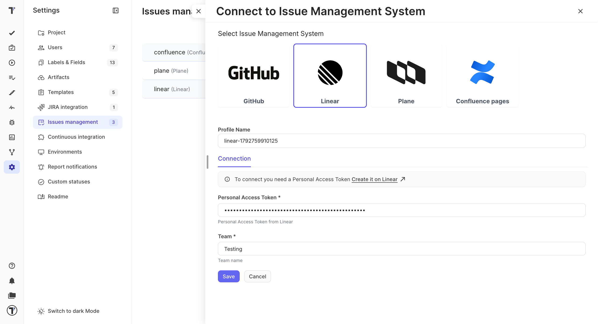
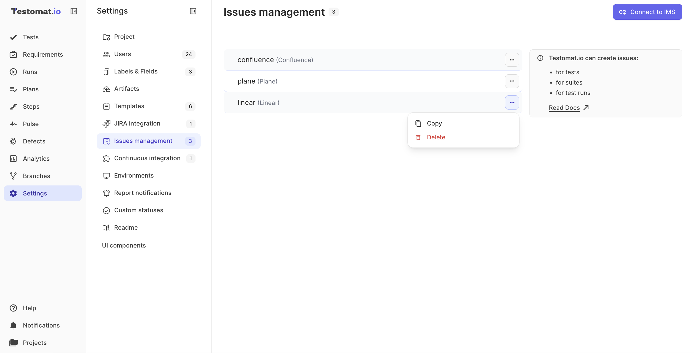
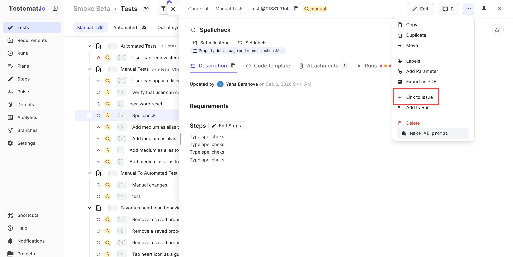
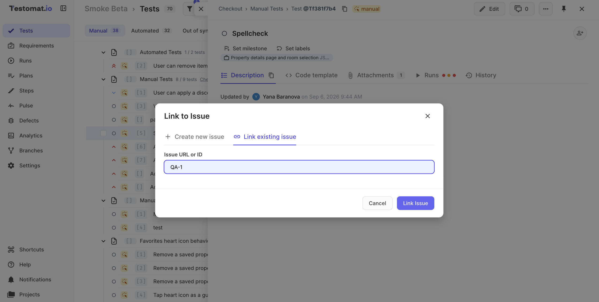
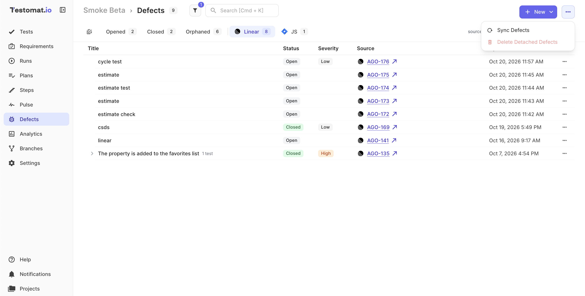

Connect your Linear team to a Testomat.io project to create issues from failing tests, link the ones you already have, and turn Linear issues into requirements.

## Create a Personal Access Token

Testomat.io connects to Linear with a personal API key. Linear calls it an **API key**; in Testomat.io the same key goes into the **Personal Access Token** field.

1. In Linear, open **Settings** and go to **Security & access**.
2. Under **Personal API keys**, click **New API key**.
3. Enter a **Key name**, for example `Testomat.io`.
4. Choose the **Permissions** and **Team access** the key gets.
5. Click **Create**.

6. Click the copy icon next to the key.

Copy the key before you leave the page - Linear shows it only once.

## Connect Linear

1. In Testomat.io, open **Settings** and go to **Issues management**.
2. Click **Connect to IMS**.
3. Select **Linear**.
4. Change the **Profile Name** if you want a different one.
5. Paste your key into **Personal Access Token**. The **Create it on Linear** link above the field opens the page where you make one.
6. Enter your team name in **Team**.
7. Click **Save**.

The new profile appears on the **Issues management** page, next to any other systems you use. To copy or delete it later, click the **⋯** button next to the profile.

## Create a Linear Issue

1. Open a test, suite, or run, click the **⋯** button in the top-right corner, and select **Link to Issue**.
2. On the **Create new issue** tab, pick your Linear profile.
3. Enter the title and description.
4. Click **Show Optional Fields** to fill in more Linear fields.
5. Click **Create Issue**.

| Field | What it sets |
| --- | --- |
| **Status** | The workflow state of the issue. |
| **Priority** | How urgent the issue is. |
| **Assignee** | Who works on it. |
| **Labels** | Linear labels. |
| **Project** and **Project milestone** | Where the issue belongs in your Linear projects. |
| **Cycle** | The cycle the issue is planned for. |
| **Estimate** | The estimate, in your team's scale. |
| **Due date** | When it should be done. |
| **Parent issue** | A parent issue, by URL or ID. |

The lists show only the values of your connected team. If your team doesn't use estimates, the **Estimate** field is turned off.

## Link an Existing Issue

1. Open a test, suite, or run, click the **⋯** button in the top-right corner, and select **Link to Issue**.
2. Open the **Link existing issue** tab.
3. Paste the Linear issue URL or its key, such as `QA-1`, into **Issue URL or ID**.
4. Click **Link Issue**.

## Raise a Defect

1. In a manual run, open a failed test and click **Raise Defect**.
2. Pick your Linear profile.
3. Click **Show Optional Fields** to set Linear fields.
4. Create the defect.

To link a defect that already exists, open **Link existing defect** and paste the key. With **Tracker** set to **Detect automatically**, Testomat.io recognizes a Linear key on its own.

## Track Linear Defects

Defects raised in Linear show up on the **Defects** page. Open the **Linear** tab to see only them, with their status, severity, and a link to each issue in Linear.

To pull the latest changes from Linear right away, click the **⋯** button in the top-right corner and select **Sync Defects**.

## See Testomat.io Items in Linear

Every linked test, suite, run, plan, requirement, or defect appears on the Linear issue as an attachment, not a comment. The issue discussion stays clean, and your team opens the testing context in one click.

## Use Linear Issues as Requirements

Add a Linear issue as a requirement to plan tests from it. Testomat.io imports the title and the description. See [Linear as a Requirement Source](https://docs.testomat.io/advanced/ai-powered-features/ai-requirements#linear-as-a-requirement-source).

Linear requirements refresh **once a day**. To pull the latest version right away, open the requirement, click the **⋯** menu, and select **Refresh Requirement**.

## Next Steps

- [Issues Management Systems](https://docs.testomat.io/integrations/issues-management)
- [AI-Requirements](https://docs.testomat.io/advanced/ai-powered-features/ai-requirements)
- [Defects](https://docs.testomat.io/project/defects)
