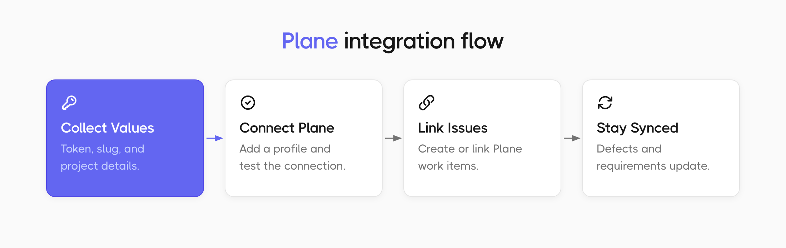
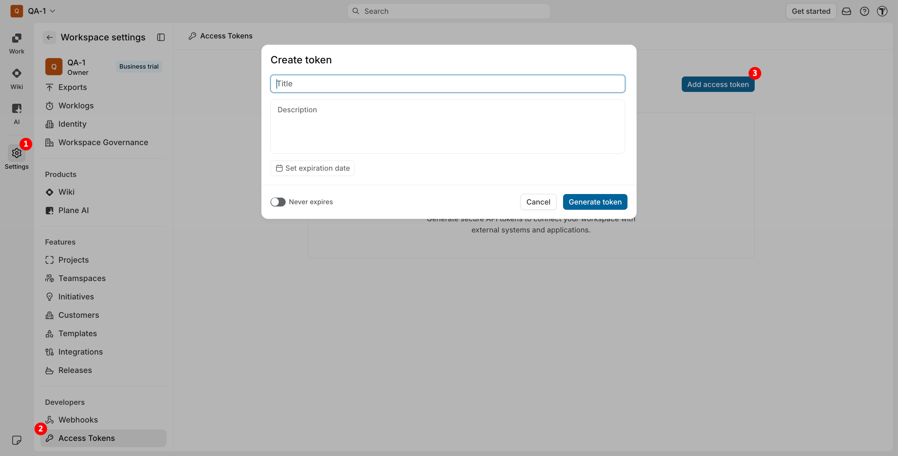
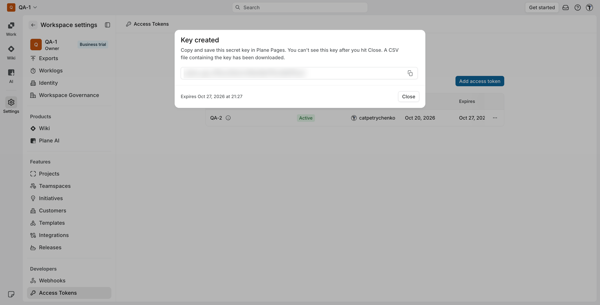
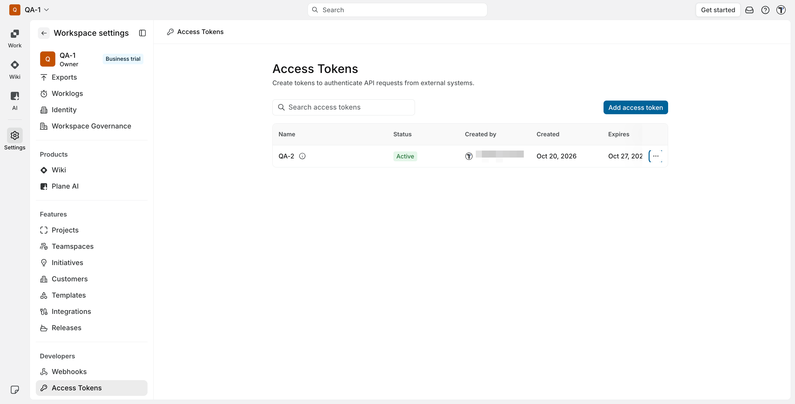
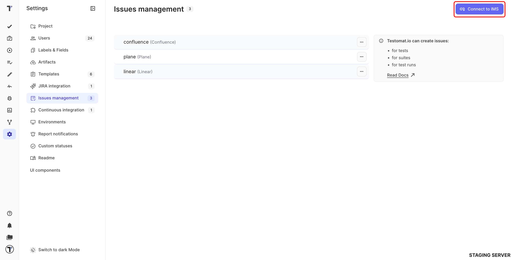
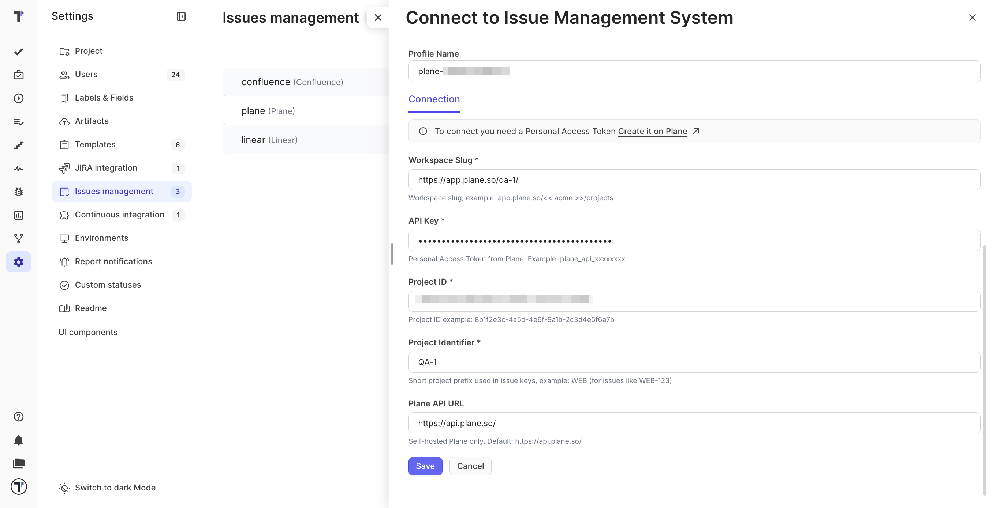

Connect your Plane workspace to a Testomat.io project to raise Plane work items from failing tests, link the ones you already have, and keep defects in step with Plane.

## Before You Start

Collect these values from Plane. They all belong to the project you want to connect.

| Value | Where to find it |
| --- | --- |
| **Personal Access Token** | Go to **Workspace settings**, then **Access Tokens** in Plane. See [Create a Personal Access Token](#create-a-personal-access-token). |
| **Workspace Slug** | The part of the URL after the domain: `app.plane.so/acme/projects` means the slug is `acme`. |
| **Project ID** | The project's UUID, for example `8b1f2e3c-4a5d-4e6f-9a1b-2c3d4e5f6a7b`. |
| **Project Identifier** | The short prefix in issue keys. If your work items look like `WEB-123`, the identifier is `WEB`. |

## Create a Personal Access Token

1. In Plane, click **Settings** in the left sidebar.
2. Under **Developers**, select **Access Tokens**.
3. Click **Add access token**.
4. Enter a **Title** and **Description**.
5. Click **Set expiration date**, or turn on **Never expires**.
6. Click **Generate token**.

:::note

Copy the key from the **Key created** window before you click **Close** - Plane shows it only once.

:::

Plane also downloads a CSV file with the key, so you have a backup.

Your token is ready - it appears in the **Access Tokens** list with the **Active** status.

## Connect Plane

1. Open **Settings** and go to **Issues management**.
2. Click **Connect to IMS**.
3. Select **Plane** from the list.

In the connection creation window, fill in the following:

1. Change the **Profile Name** if you want a different one.
2. Enter your **Workspace Slug**.
3. Paste your **Personal Access Token**. 
4. Enter the **Project ID**.
5. Enter the **Project Identifier**.
6. Leave **Plane API URL** empty, unless you run Plane yourself.
7. Click **Test Connection**. Testomat.io checks the token, the workspace, and the project before anything is saved.
8. Click **Save**.

The new profile appears on the **Issues management** page. A project can hold several profiles at once, so Plane can sit next to Jira or Linear.

:::note

**Plane API URL** is for self-hosted Plane only. When the field is empty, Testomat.io uses `https://api.plane.so`.

:::

## Create a Plane Issue from a Test

1. Go to the **Tests** page.
2. Open a test or a suite.
3. Click the (`...`) menu and select **Link to Issue**.
4. Pick your Plane profile.
5. Click **Create new issue**.

The work item appears in your Plane project with the description and a link back to the test, and its Plane URL shows on the test. You can do the same for a suite or for a failed test in a run report.

## Link an Existing Plane Issue

Paste the Plane URL into **Link to Issue**. Testomat.io recognizes it as Plane, pulls in the title, and shows it with the Plane icon.

Plane gets a comment on the work item with a link back to Testomat.io, so the connection is visible from both sides.

## Defects Stay in Step with Plane

A defect raised from a Plane link keeps its title, description, status, severity, and comments in step with the work item. Edit the defect in Testomat.io and the change goes back to Plane.

Severity and Plane priority map onto each other both ways:

| Testomat.io severity | Plane priority |
| --- | --- |
| **critical** | urgent |
| **high** | high |
| **medium** | medium |
| **low** | low |
| none | no priority |

## Keep Requirements Up to Date

Plane items you add as requirements refresh **once a day**, so edits made in Plane reach Testomat.io on their own.

When you need the latest version right away, refresh that requirement by hand:

1. Go to the **Requirements** page.
2. Open the requirement.
3. Click the (`...`) menu.
4. Select **Refresh Requirement**.

For everything requirements can do once they are in, see [AI-Requirements](https://docs.testomat.io/advanced/ai-powered-features/ai-requirements).

## If This Doesn't Work

- **Test Connection fails.** Check the **Workspace Slug** against the URL in Plane, and make sure the token belongs to a user who can see that project.
- **The issue search finds nothing.** Check the **Project ID**. It is the UUID, not the short prefix - the prefix goes into **Project Identifier**.
- **A link opens the API address instead of the issue.** Clear the **Plane API URL** field. It stays empty unless you run Plane yourself.
- **Nothing connects on a self-hosted Plane.** Fill in **Plane API URL** with your own API address.
- **A requirement still shows the old text.** The daily refresh has not run yet. Use **Refresh Requirement** to pull it now.

## Next Steps

- [Issues Management Systems](https://docs.testomat.io/integrations/issues-management)
- [Defects](https://docs.testomat.io/project/defects)
- [AI-Requirements](https://docs.testomat.io/advanced/ai-powered-features/ai-requirements)
