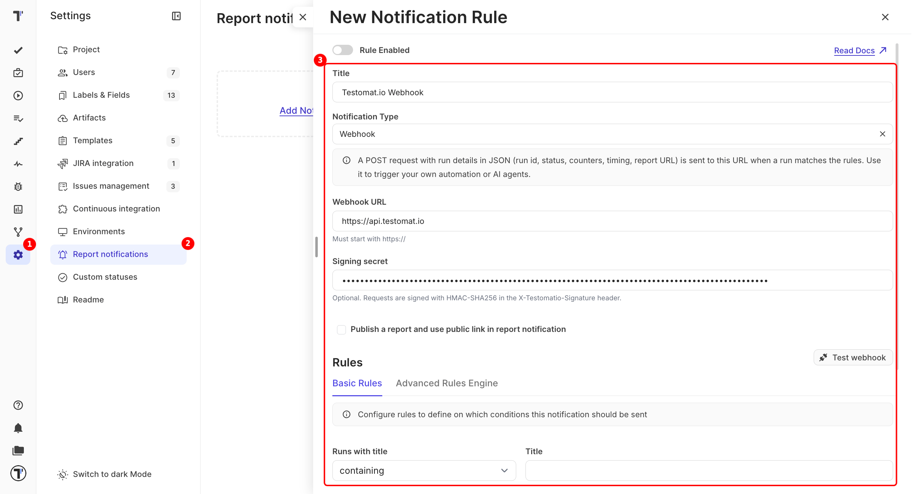

Get a JSON request on your own server every time a run finishes and matches your rules. Use it to analyze failures with AI, start a follow-up CI job, update a release gate, or send results to your own dashboard.

:::note

You need an endpoint that accepts `POST` requests over HTTPS.

:::

## Set Up a Webhook

1. Open **Settings** and go to **Report notifications**.
2. Click **Add Notification Rule**.
3. Enter a **Title** for the rule.
4. Select **Webhook** in **Notification Type**.
5. Paste your endpoint into **Webhook URL**. It must start with `https://`.
6. Enter a **Signing secret** if you want to check that requests come from Testomat.io (optional).
7. Set the conditions on the **Basic Rules** or **Advanced Rules Engine** tab, for example: send only when the run has failures.
8. Click **Test webhook**. Testomat.io sends a sample run to your endpoint.
9. Turn on **Rule Enabled** at the top of the form.
10. Click **Save**.

:::note

Select **Publish a report and use public link in report notification** to add a public link to the report in each request.

:::

## What the Request Contains

Each request is a `POST` with a JSON body and these headers:

| Header | Value |
| --- | --- |
| `Content-Type` | `application/json` |
| `User-Agent` | `Testomatio-Webhook` |
| `X-Testomatio-Event` | `run.finished` |
| `X-Testomatio-Signature` | `sha256=<signature>`. Sent only when a signing secret is set. |

The body includes the project, the rule that fired, and the run:

| Field | What it holds |
| --- | --- |
| `id`, `url` | The run ID and a direct link to the report. |
| `status` | The run status. |
| `passed`, `failed`, `skipped`, `tests_count` | Test totals. |
| `env`, `labels`, `plans` | The environment, labels, and plans of the run. |
| `ci_build_url` | A link to the CI build. |
| `rungroup_id`, `rungroup_path` | The run group the run belongs to. |
| `launched_at`, `finished_at` | When the run started and finished. |

To get test-level details, use the run ID with [Public API v2](https://docs.testomat.io/advanced/api-access/#public-api-v2) or the MCP Server.

## Check the Signature

A signing secret lets your server make sure a request really came from Testomat.io. When you set one, Testomat.io signs the raw request body with HMAC-SHA256 and sends the result in the `X-Testomatio-Signature` header. Compute the same signature on your side with your secret and compare the two. If they match, the request came from Testomat.io.

## Limits

- Only HTTPS endpoints on public addresses are accepted. Redirects are not followed.
- Your endpoint has 10 seconds to answer. If it fails or returns an error, Testomat.io tries again, up to 5 times.
- Several rules with the same URL and secret send one request per run.
- For a run group rule, the request carries the run whose finish triggered it.

## If This Doesn't Work

- **Nothing arrives.** Check that **Rule Enabled** is on. Then click **Test webhook** and make sure your endpoint answers with a `2xx` status within 10 seconds.
- **The signature doesn't match.** Compute it from the raw body, before your framework parses the JSON.

## Next Steps

- [Notification Rules](https://docs.testomat.io/integrations/report-notifications/rules)
- [Public API](https://docs.testomat.io/advanced/api-access)
