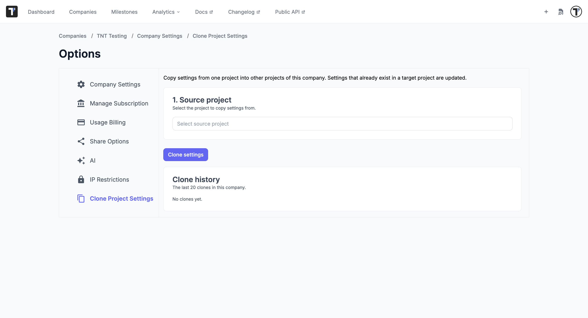

Set up a new project in minutes by copying the configuration of one you already have. Your tests and runs stay where they are; only the settings are copied.

:::note

Clone Project Settings is available to company owners on the Enterprise plan.

:::

To copy a whole project together with its tests, use **Clone Project** on the Project board instead. See [Project Actions](https://docs.testomat.io/management/company/administration#project-actions).

## Clone the Settings

1. Go to **Companies**, open your company, and select **Company Settings**.
2. Select **Clone Project Settings** in the menu on the left.
3. Under **1. Source project**, select the project to copy settings from.
4. Select what to copy. You can pick single items or a whole category.
5. Select one or more target projects.
6. Click **Clone settings**, then confirm with **Clone**.

Settings that already exist in a target project are updated, so you can run a clone again whenever the source project changes.

Testomat.io shows the result for every item, and the last 20 clones in your company stay in **Clone history**.

## What You Can Clone

| Category | What it includes |
| --- | --- |
| **Jira integration** | The Jira connection of the project. |
| **Issue Management** | Issue management profiles. |
| **Artifacts** | Artifact storage settings. |
| **Labels & Fields** | Labels and custom fields. |
| **Templates** | Test and suite templates. |
| **Environments** | Run environments. |
| **Custom Statuses** | Custom test statuses. |

## Next Steps

- [Company Administration](https://docs.testomat.io/management/company/administration)
- [Plan Features Comparison](https://docs.testomat.io/management/company/plan-features-comparison)
