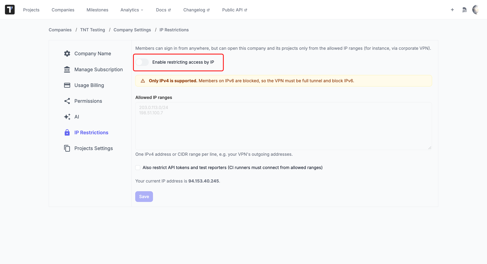

Keep your company data inside your network. With IP restrictions, members open your company and its projects only from the IP addresses you allow, for example your corporate VPN. Members can still sign in from anywhere.

:::note
IP Restrictions are available on the Enterprise plan. Only the company owner can change them.
:::

## Set Allowed IP Ranges

1. Click **Companies** in the header.
2. Click **Settings**.
3. Select **IP Restrictions** in the left menu.
4. Turn on **Enable restricting access by IP**.
5. In **Allowed IP ranges**, enter one IPv4 address or CIDR range on each line.
6. To limit the API too, select **Also restrict API tokens and test reporters**.
7. Click **Save**.

Done. Members can now open your company only from the allowed ranges. The page shows your current IP address, so you can check it before you save.

:::caution
Only IPv4 is supported. Members who connect over IPv6 are blocked. Make sure that your VPN is full tunnel and blocks IPv6.
:::

The API option is off by default, because CI runners often use changing IP addresses. When you turn it on, your CI runners must connect from the allowed ranges.

## Access from Other Addresses

A member outside the allowed ranges can still sign in and open other companies. They cannot open your company or its projects. They see a message with their IP address and a hint to check the VPN.

You can always open **Company Settings** from any address, so you cannot lock yourself out.

## Turn Off IP Restrictions

1. Select **IP Restrictions** in **Company Settings**.
2. Turn off **Enable restricting access by IP**.
3. Confirm the action.

Everyone can open the company again. If you turn the restriction on again in the same browser, your ranges come back. Click **Save** to apply them.

## Next Steps

- [Administration](https://docs.testomat.io/management/company/administration)
- [Plan Features Comparison](https://docs.testomat.io/management/company/plan-features-comparison)
