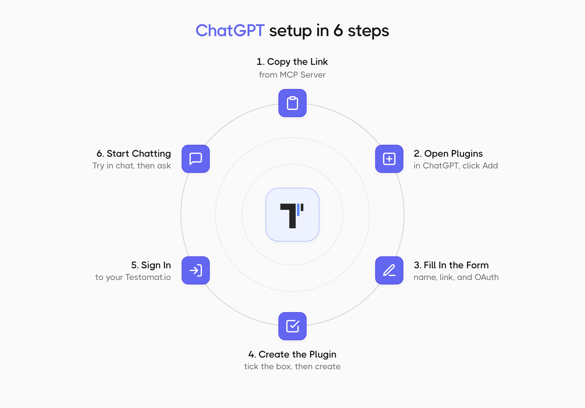
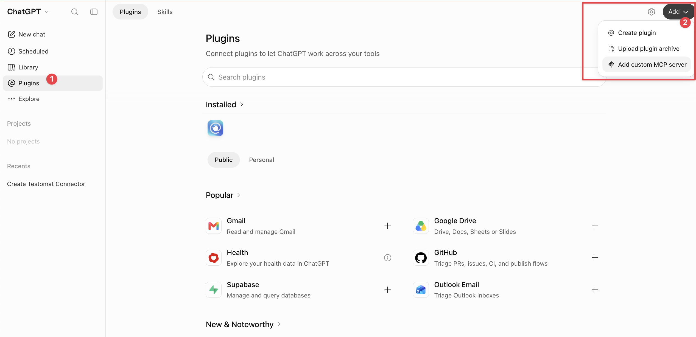
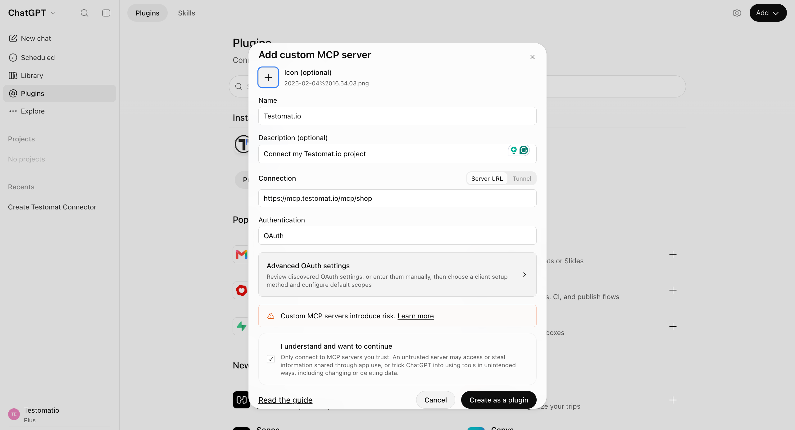
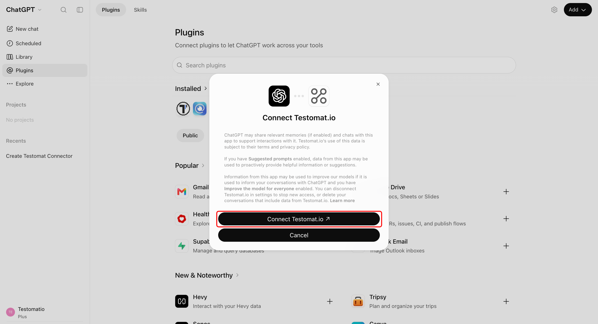
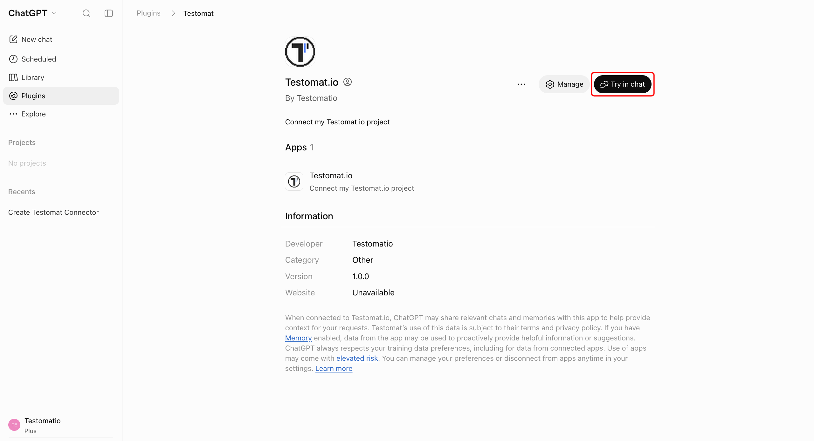
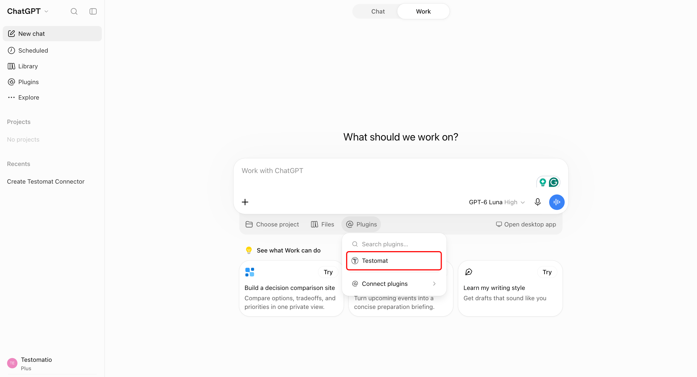

Connect ChatGPT to your Testomat.io project. ChatGPT reads your tests, runs, and failures, and can create and update test cases for you. You sign in with your Testomat.io account, so ChatGPT gets the same access you have. No tokens to create, no config files to edit.

:::note

The MCP Server is part of the AI-powered features. If the menu item is greyed out, turn them on first - see [AI-Powered Features](https://docs.testomat.io/advanced/ai-powered-features). If you use Claude instead, see [MCP - Connect Claude](https://docs.testomat.io/tutorials/connect-claude-to-testomat).

:::

## Copy the Connector URL

1. Open the **Tests** page in the project you want to connect.
2. Click the (`...`) menu in the top-right corner and select **MCP Server**.
3. On the **Chats** tab, click the copy icon next to the connector URL.

The URL ends with your project name, so each project has its own. Copy it from the project you want ChatGPT to work with.

## Add Testomat.io as a Plugin

1. In ChatGPT, click **Plugins** in the left sidebar.
2. Click **Add** in the top-right corner and select **Add custom MCP server**.

In a new pop-up, fill in the following:

1. Enter `Testomat.io` in **Name**. 
2. Under **Connection**, keep **Server URL** selected and paste the connector URL.
3. Choose **OAuth** in **Authentication**. 
4. Select **I understand and want to continue**.
5. Click **Create as a plugin**.

## Sign In to Testomat.io

1. In the **Connect Testomat.io** window, click **Connect Testomat.io**.
2. Sign in to Testomat.io and approve the access ChatGPT is asking for.

Testomat.io now shows under **Installed** on the **Plugins** page.

## Use Testomat.io in a Chat

To start using your connector in a new chat right away:

1. Open the **Testomat.io** plugin page.
2. Click **Try in chat**.

To use it in a new chat later, click **Plugins** below the message box and select **Testomat**. Ask something simple, like `How many tests are in my project?`, and you'll get an answer straight from your project.

## What You Can Ask

ChatGPT works with your tests in plain language. A few examples to start with:

| You want to | Ask |
| --- | --- |
| See what failed | `Show me the failed tests from the last run` |
| Find gaps in coverage | `Find all tests tagged @smoke that have no steps` |
| Add a test | `Create a test "User logs in with valid credentials" in the Authentication suite` |

ChatGPT can read and change the same things you can, so anything it writes appears in your project right away.

## If This Doesn't Work

- **There is no Add custom MCP server option.** Ask your workspace admin to turn them on.
- **Testomat is missing from the Plugins menu in a chat.** Check that Testomat.io shows under **Installed** on the **Plugins** page. If it doesn't, add it again.
- **Sign-in finishes but no tests appear.** Copy the URL again from the **Chats** tab. The URL is tied to one project, and a URL from another project will not work.

## Next Steps

- [MCP - Connect Claude](https://docs.testomat.io/tutorials/connect-claude-to-testomat)
- [MCP - Connect with a Config File](https://docs.testomat.io/tutorials/mcp-connection)
- [AI-Powered Features](https://docs.testomat.io/advanced/ai-powered-features)
