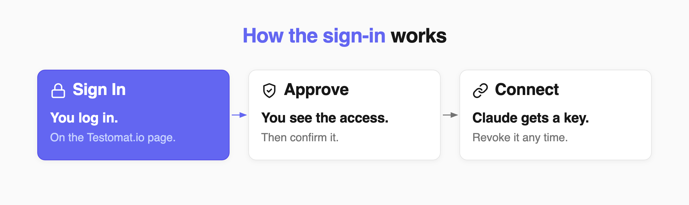
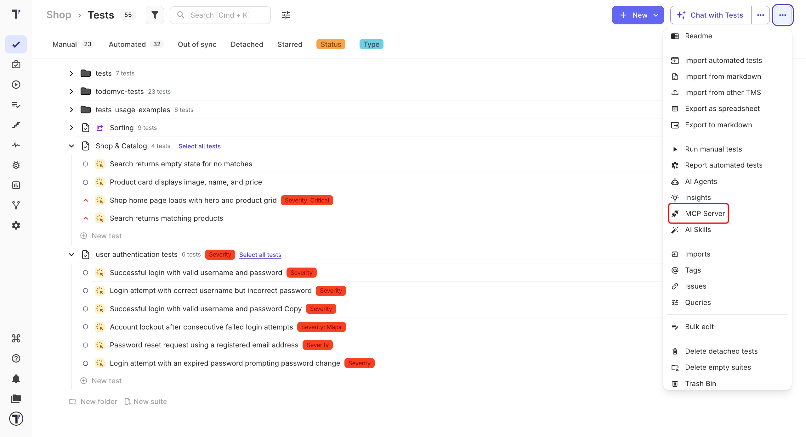
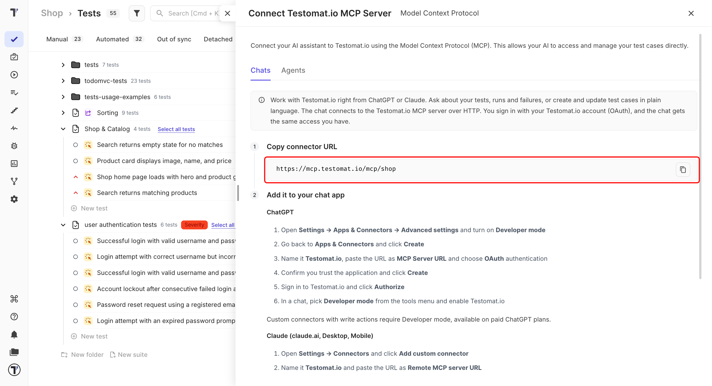
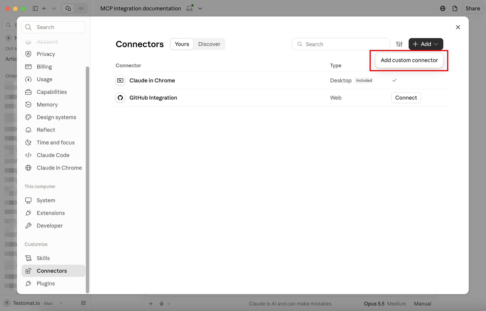
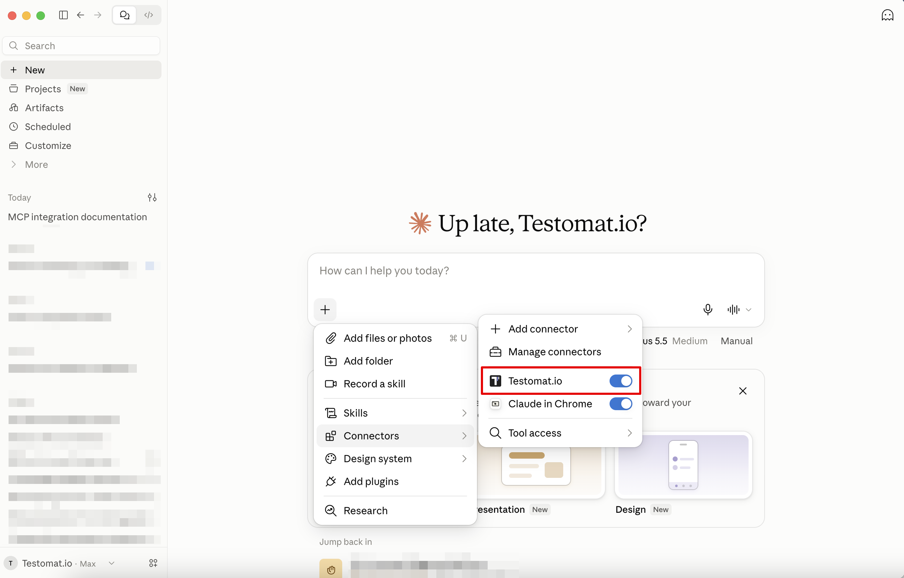

Connect Claude to your Testomat.io project and ask about your tests in plain language. Claude reads your tests, runs, and failures, and can create and update test cases for you.

You sign in with your Testomat.io account, so Claude gets the same access you have. No tokens to create, no config files to edit.

This is the quickest way, and it works for Claude in the browser, on the desktop, and on your phone. If you use Cursor or OpenCode, connect them with [a config file](https://docs.testomat.io/tutorials/mcp-connection) instead.

:::note

The MCP Server is part of the AI-powered features. If the menu item is greyed out, turn them on first — see [AI-Powered Features](https://docs.testomat.io/advanced/ai-powered-features).

:::

## Copy the Connector URL

1. Open the **Tests** page in the project you want to connect.
2. Click the **⋯** menu in the top-right corner and select **MCP Server**.
3. On the **Chats** tab, click the copy icon next to the connector URL.

The URL ends with your project name, so each project has its own. Copy it from the project you want Claude to work with.

:::note

You can also reach this window from the **Chat with Tests** panel — the line **Prefer your own AI assistant?** links to the same place.

:::

## Add the Connector in Claude

1. In Claude, open **Settings**.
2. Navigate to **Connectors**.
3. Click **+ Add** and select **Add custom connector**.
4. Name it `Testomat.io` and paste the URL into **Remote MCP server URL**.
5. Click **Add**, then **Connect**, and sign in to Testomat.io.
6. Review the access Claude is asking for, then click **Authorize**.

Claude now shows **Testomat.io** in the connectors list.

:::note

On Claude Team and Enterprise plans, an organization owner adds the connector once in **Admin settings** → **Connectors**. Everyone else then connects their own Testomat.io account.

:::

## Claude Chat with Testomat.io

1. Open a chat.
2. Click the **+** icon below the message box.
3. Navigate to **Connectors**.
4. Enable **Testomat.io**.

## Work with Claude Chat

Claude works with your tests in plain language. A few examples to start with:

| You want to | Ask |
| --- | --- |
| See what failed | `Show me the failed tests from the last run` |
| Find gaps in coverage | `Find all tests tagged @smoke that have no steps` |
| Add a test | `Create a test "User logs in with valid credentials" in the Authentication suite` |

Claude can read and change the same things you can, so anything it writes appears in your project right away.

## If This Doesn't Work

- **The MCP Server menu item is greyed out.** AI features are off for the project. Turn them on in the project settings, then reopen the menu.
- **Sign-in finishes but Claude shows no tests.** Check that the connector is enabled in the tools menu of the chat you are in.
- **The URL was pasted but nothing connects.** Copy it again from the **Chats** tab — the URL is tied to one project, and a URL from another project will not work.

## Next Steps

- [MCP - Connect ChatGPT](https://docs.testomat.io/tutorials/connect-chatgpt-to-testomat)
- [MCP - Connect with a Config File](https://docs.testomat.io/tutorials/mcp-connection)
- [Test Query Language (TQL)](https://docs.testomat.io/advanced/tql)
- [API Access](https://docs.testomat.io/advanced/api-access)
